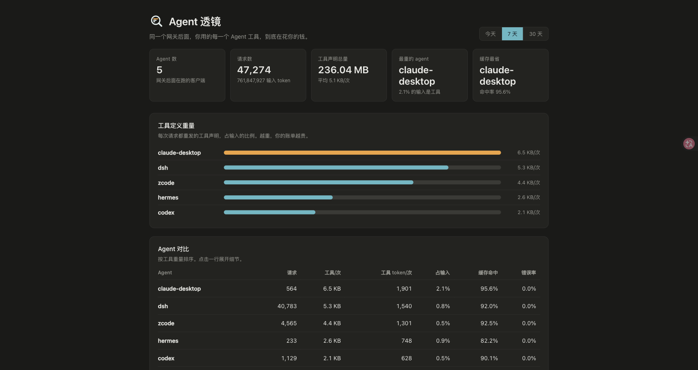

<p align="center">
  <picture>
    <source srcset="brand/assets/mark-dark.svg" media="(prefers-color-scheme: dark)">
    
  </picture>
</p>

# Agent Lens

> 看清楚：同一个网关后面，你用的每一个 Agent 工具，到底在花你的钱。

英文名：Agent Lens · A magpie gateway plugin that shows what each agent behind
your gateway actually costs you — tokens, money, and the weight of the tool
definitions it re-sends on every turn.

## 它解决什么

你同时用 Claude Code、Codex、Cursor、DSH、zcode……它们都连到同一个 magpie 网关。
但你不知道：

- 哪个 agent 在烧钱最多？
- 哪个 agent 每轮请求都重发一大堆工具定义（这是 input token 的大头）？
- 哪个 agent 报错最多、最不稳定？

magpie 的用量页只按 **模型** 统计，不按 **agent**。Agent Lens 从网关请求里采集，
按 agent 聚合出这三个维度的对比。

## 工作方式

```
magpie hooks (Bun)  →  本地 JSON  →  本地服务  →  页面
  每个请求的 agent/模型/token/工具定义重量     HTTP     对比视图
```

- **零干扰**：只观测，不改写任何请求
- **零隐私风险**：只记录 agent 名、模型名、token 数字和工具定义的**尺寸**，不记录对话内容
- **本地优先**：数据只在你本机，插件不联网上报

## 安装

```sh
magpie plugin add github:webkubor/agent-lens
```

## 预览



> 截图说明：请求数、token、缓存命中来自作者本机网关的真实用量记录；**「工具定义重量」那几列是模拟数据**，用来演示版面。真实数值要等 hooks 接入网关后采集。

## 品牌

| Token | 色值 | 用法 |
|---|---|---|
| primary | `#13606E` 深青 | 浅底主色、选中态 |
| accent | `#F0A23B` 琥珀 | 只标「最重 / 最贵」的那一项 |
| onDark | `#E6F1F0` | 深底上的标识 |

标识：放大镜罩住三根长短不一的条，表示把网关后面的几个 agent 摆在一起比，最长那根（最花钱的）用琥珀色。源文件与评审页在 [`brand/`](brand/)。

## 状态

开发中（MVP）。页面与汇总逻辑已在本机用真实用量验证；hooks 采集端尚未接入真实网关做端到端验证。
